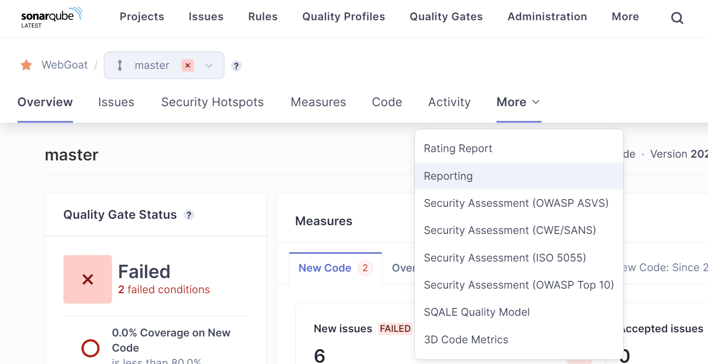
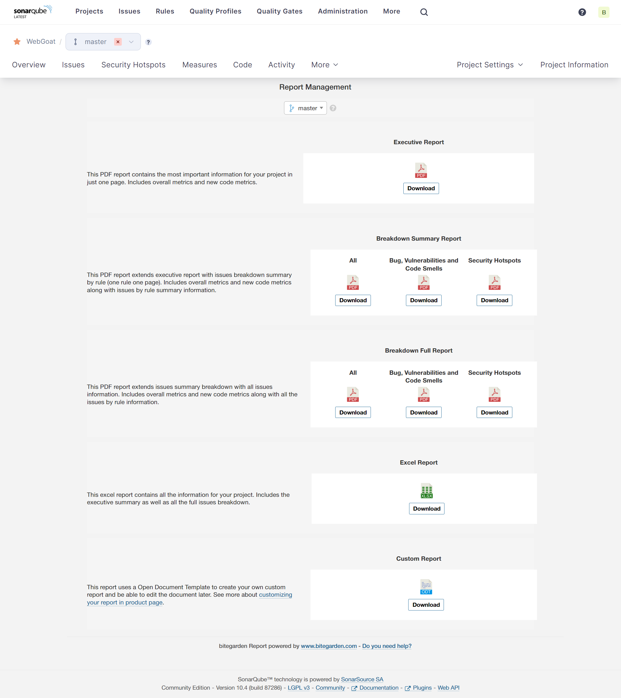

Si quieres **exportar informes de los resultados** de los análisis de los proyectos de SonarQube, estas en el artículo adecuado. A continuación, te vamos a explicar paso por paso cómo puedes generar estos informes. 

<h2>Paso 1: Descargar el Report Plugin for SonarQube</h2>

El [Report Plugin for SonarQube Server](https://marketplace.bitegarden.com/product/bitegardenReport) genera automáticamente informes de tus proyectos de SonarQube. Para empezar, [descarga la versión de prueba gratuita de 14 días para Server](https://marketplace.bitegarden.com/download/download-form/55).

Si utilizas Cloud, consulta la ficha de [Report for SonarQube Cloud](https://marketplace.bitegarden.com/product/bitegardenSonarCloudReport) o [descarga la versión de prueba gratuita de 14 días para Cloud](https://marketplace.bitegarden.com/download/download-form/64).

Por otro lado, te dejamos [aquí](/es/sonarqube-report-documentation) las instrucciones de instalación. Verás que es muy sencillo completar este paso.

<h2>Paso 2: Generar los informes</h2>

Una vez hayas finalizado el proceso de instalación ya podrás visualizar tus **primeros informes**.

Accede al proyecto que quieras. En este ejemplo que vamos a ver a continuación, accedemos al proyecto llamado **WebGoat** y clicamos sobre *More > Reporting (esto aparecerá cuando hayamos instalado el Report Plugin for SonarQube)*.

 
 

En la siguiente pantalla verás que ya tienes generados los **reports en PDF, ODT y Excel**, listos para su descarga.
 
 

 
 

Además, desde la [release 2.19](/report-sonarqube-nueva-version-2-19) el Report Plugin for SonarQube incluye informes con solo **información de Bugs, Vulnerabilidades y Code Smells** y otro con información **sobre HotSpots**. 
 
 

<h2>Paso 3: Generar los informes</h2>

Cada informe generado tiene un botón, así que únicamente tendrás que **clicar sobre el botón que quieras** para descargar tus informes. 
 
 

<h3>Videotutorial del proceso</h3>

Para que lo veas más claro, en el siguiente vídeo te mostramos cómo puedes crear estos informe de SonarQube y exportarlos en **PDF, plantilla editable ODT y/o Excel**. 

<iframe width="560" height="315" src="https://www.youtube.com/embed/kZ8RCEuCWW4" title="YouTube video player" frameborder="0" allow="accelerometer; autoplay; clipboard-write; encrypted-media; gyroscope; picture-in-picture; web-share" allowfullscreen></iframe>

Por cierto, tenemos disponible una oferta del **20% de descuento para el Pack Premium bitegarden**, que incluye todos los productos para SonarQube o para SonarCloud. Puedes aprovechar esta oferta a través de la página de [descarga de productos](https://www.bitegarden.com/es/products/)

---
**bitegarden team**

_Helping companies to develop better software_
