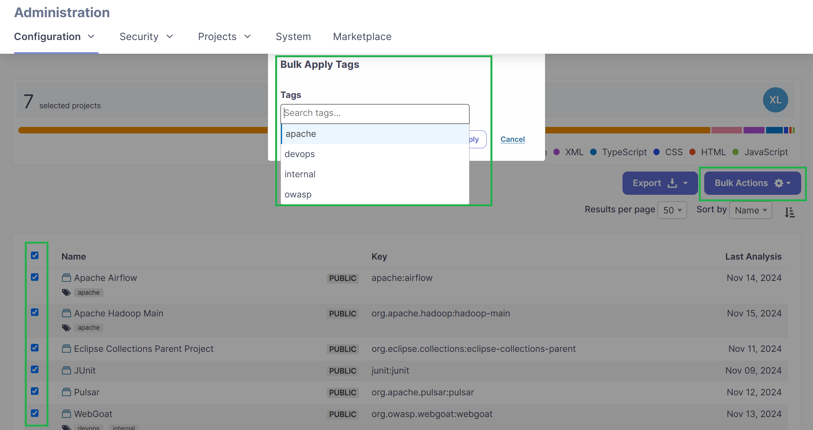
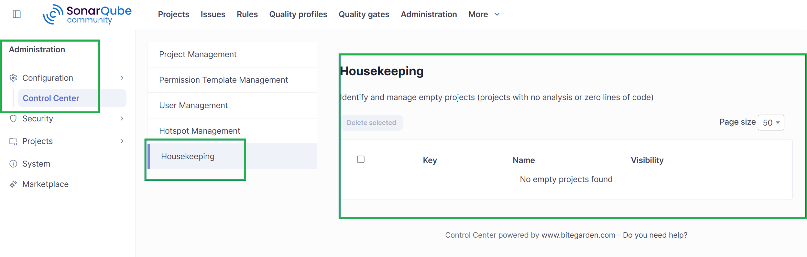
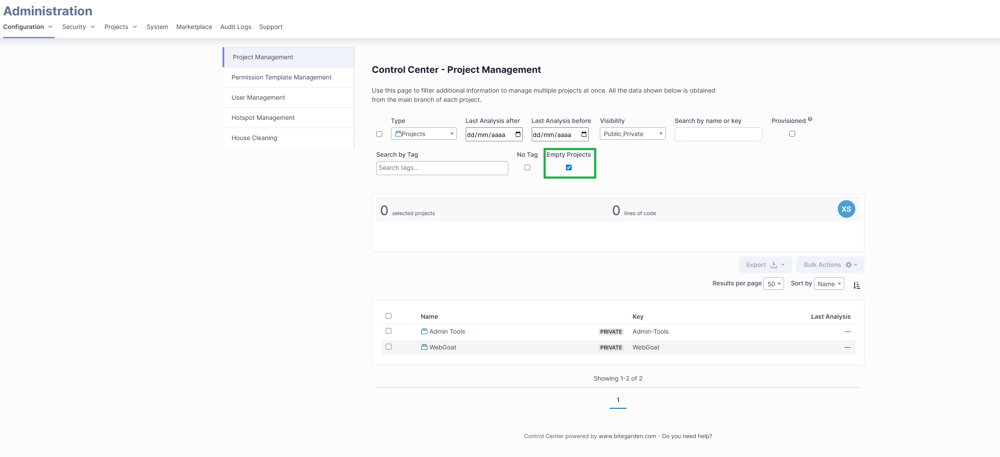

Managing a few projects in SonarQube is relatively straightforward. But what happens when an organization has dozens or even hundreds of projects to manage?

Finding inactive projects, reviewing users, organizing tags, and performing repetitive administrative tasks can take a lot of time. As the number of projects grows, keeping a SonarQube instance organized becomes increasingly challenging for administrators.

In this guide, we'll explore **how to manage multiple SonarQube projects**, optimize administrative tasks, and simplify instance management with Control Center for SonarQube Server.

<h2>Why is managing multiple SonarQube projects challenging?</h2>

As development teams grow, **the number of projects analyzed in SonarQube also increases**. Administrators need to keep their instances organized, monitor project activity, and ensure that users and security reviews are properly managed.

One of the most common challenges is **project accumulation**. When an instance contains hundreds of applications, finding a specific project or identifying those that are no longer being analyzed can take more time than necessary.

On top of that, **repetitive tasks such as updating tags, reviewing users, or checking administrative information across different projects** can become time-consuming. Although each operation may seem simple, performing it individually across numerous projects significantly increases the workload.

The solution isn't necessarily to spend more time on SonarQube administration, but to **improve the way you manage it**. Here are some practical recommendations and solutions to help you manage your SonarQube instance more efficiently.

<h2>1. Organize your SonarQube projects with tags</h2>

One of the easiest ways to improve SonarQube administration is to establish a **consistent tagging system**. Tags help categorize projects and make them easier to find, especially when multiple teams share the same instance.

For example, you can use tags to identify the team responsible for each project (`backend`, `frontend`, or `devops`), the business unit it belongs to (`finance`, `marketing`, or `operations`), or the application type (`api`, `mobile`, or `web`).

With **Control Center for SonarQube Server**, you can apply tags to multiple projects in bulk. You can also filter projects by tags, identify projects without assigned tags, and rename tags across multiple projects at once.

<h2>2. Identify inactive SonarQube projects</h2>

Not every project in a SonarQube instance remains active. Some may belong to applications that are no longer used, completed initiatives, or repositories that are no longer being analyzed.

Over time, these projects **can accumulate and make relevant information harder to find**. That's why a good maintenance strategy involves **regularly reviewing** project activity and identifying projects that may have become obsolete.

SonarQube Server provides administrative features for viewing projects and their activity. You can learn more about its capabilities on the <a href="https://www.sonarsource.com/products/sonarqube/" target="_blank" rel="nofollow noopener noreferrer">official Sonar website</a>.

Control Center allows you to **search for projects by name, key, activity, or last analysis date**. It also includes *Housekeeping* features to identify empty projects and review those that no longer contain useful information.

This helps administrators quickly identify projects that need attention and decide which ones should be maintained.

<h2>3. Reduce repetitive tasks with bulk operations</h2>

Imagine you need to add the same tag to 80 SonarQube projects. If you do this individually, you'll have to repeat the same process dozens of times.

SonarQube Server already includes certain bulk administration capabilities, such as **deleting projects or applying permission templates**. However, administrators may need additional tools to organize their projects more flexibly.

Control Center extends these capabilities **with advanced filters and bulk tagging operations**. Instead of accessing each project individually, you can identify the projects **you need to update and apply** the available actions from a centralized interface.

<h2>4. Review users and security administration</h2>

Managing SonarQube isn't just about organizing projects. It's also important to know **which users have access to your instance**, review specific configurations, and maintain traceability of security reviews.

Control Center includes features that help simplify these tasks.

In the user management section, administrators can **view instance users, apply filters, and review information related to their identity providers**. This makes regular administrative checks easier and helps locate relevant information without navigating through multiple screens.

When it comes to security, the plugin includes tools for managing **Security Hotspots**, particularly those that have been reviewed without comments. You can filter them by status, such as `SAFE`, `FIXED`, or `ACKNOWLEDGED`, and add comments in bulk when needed.

<h2>5. Simplify SonarQube administration with Control Center</h2>

If you're responsible for **managing multiple SonarQube projects**, having a tool that centralizes administrative tasks can help you work more efficiently.

Control Center for SonarQube Server is a bitegarden plugin specifically designed for administrators who need to keep their instances organized and reduce the time spent on manual operations.

With its advanced filters, you can find projects using different criteria, identify those that haven't been analyzed recently, and detect empty projects. You can also apply tags in bulk, export administrative information, and access relevant data about instance activity.

If you'd like to learn more about the improvements introduced in the plugin, check out our article on the [Control Center 1.8 release and its new Housekeeping features](https://www.bitegarden.com/lanzamiento-control-center-sonarqube-server-1-8).

You can also discover how bulk tagging capabilities have evolved in our article about [Control Center for SonarQube version 1.6](https://www.bitegarden.com/nuevo-sonarqube-control-center-version-1-6).

<h3>Try Control Center for free</h3>

Want to spend less time on administrative tasks and keep your SonarQube projects better organized?

**Control Center for SonarQube Server helps you simplify project management, user administration, and security reviews from a centralized interface.**

Explore its features and see how it can make your daily SonarQube administration easier.

**[Download Control Center](https://marketplace.bitegarden.com/product/bitegardenControlCenter)**

---

**bitegarden team**

_Helping companies to develop better software_