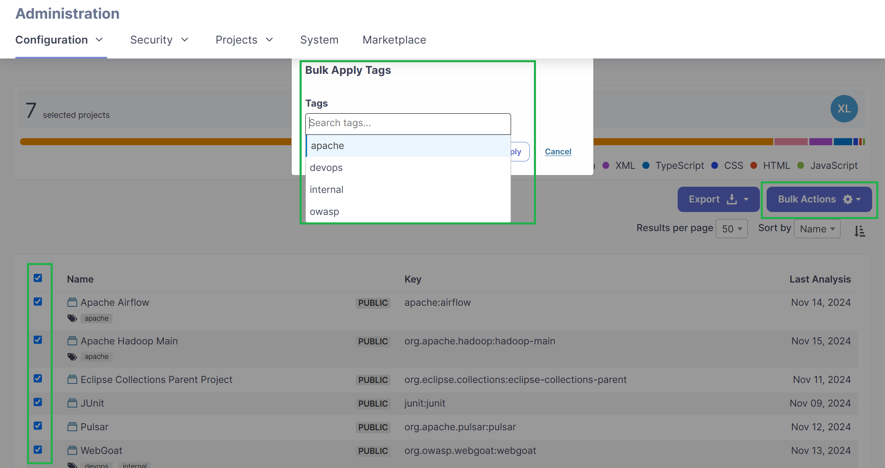
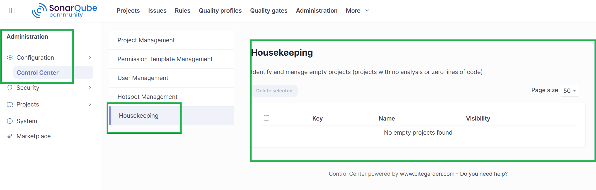
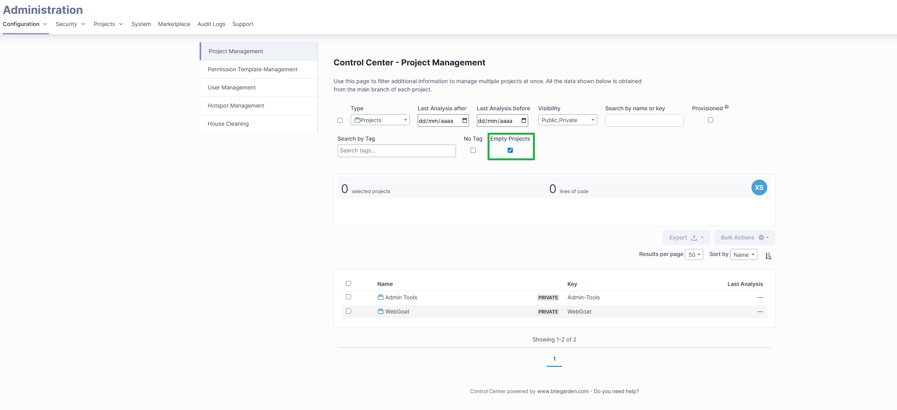

Gestionar unos pocos proyectos en SonarQube es relativamente sencillo. Pero ¿qué ocurre cuando una organización tiene decenas o incluso cientos de proyectos que administrar?

Localizar proyectos inactivos, revisar usuarios, organizar etiquetas y realizar tareas administrativas repetitivas puede consumir mucho tiempo. A medida que crece el número de proyectos, mantener una instancia organizada se convierte en un desafío para los administradores.

En esta guía veremos **cómo gestionar múltiples proyectos de SonarQube**, optimizar las tareas administrativas y simplificar la gestión de la instancia con Control Center for SonarQube Server.

<h2>¿Por qué es complicado administrar muchos proyectos de SonarQube?</h2>

A medida que crecen los equipos de desarrollo, también **aumenta el número de proyectos analizados en SonarQube**. Los administradores deben mantener la instancia organizada, controlar la actividad de los proyectos y garantizar que los usuarios y las revisiones de seguridad se gestionen correctamente.

Uno de los problemas más habituales es la **acumulación de proyectos**. Cuando una instancia contiene cientos de aplicaciones, localizar un proyecto concreto o identificar cuáles han dejado de analizarse puede requerir más tiempo del necesario.

A esto se suman las **tareas repetitivas, como actualizar etiquetas, revisar usuarios o consultar información administrativa de diferentes proyectos**. Aunque cada operación pueda parecer sencilla, realizarla de forma individual en numerosos proyectos aumenta considerablemente el trabajo.

La solución no consiste necesariamente en dedicar más horas a SonarQube, sino en **mejorar la forma de administrarlo**. Así que aquí te vamos a dejar una serie de recomendaciones y soluciones para mejorar la administración de una instancia de SonarQube. 

<h2>1. Organiza tus proyectos de SonarQube mediante etiquetas</h2>

Una de las formas más sencillas de mejorar la administración de SonarQube es establecer un **sistema de etiquetas coherente**. Esta funcionalidad permite clasificar proyectos y facilita su localización, especialmente cuando varios equipos comparten una misma instancia.

Por ejemplo, puedes utilizar etiquetas para identificar el equipo responsable de cada proyecto (`backend`, `frontend` o `devops`), la unidad de negocio a la que pertenece (`finanzas`, `marketing` u `operaciones`) o el tipo de aplicación (`api`, `mobile` o `web`).

Con **Control Center for SonarQube Server** puedes aplicar etiquetas a múltiples proyectos de forma masiva. Además, permite filtrar proyectos por etiquetas, identificar aquellos que no tienen ninguna asignada y renombrar etiquetas en varios proyectos a la vez.

  

<h2>2. Identifica los proyectos inactivos de SonarQube</h2>

No todos los proyectos de una instancia de SonarQube se mantienen activos. Algunos pueden pertenecer a aplicaciones que ya no se utilizan, iniciativas finalizadas o repositorios que han dejado de analizarse.

Con el tiempo, estos proyectos **pueden acumularse y dificultar la localización** de información relevante. Por eso, una buena estrategia de mantenimiento consiste en **revisar periódicamente** la actividad de los proyectos y detectar aquellos que podrían haber quedado obsoletos.

SonarQube Server dispone de funcionalidades administrativas para consultar proyectos y su actividad. Puedes encontrar más información sobre sus capacidades en la <a href="https://www.sonarsource.com/products/sonarqube/" target="_blank" rel="nofollow noopener noreferrer">web oficial de Sonar</a>.

Control Center permite buscar **proyectos por nombre, clave, actividad o fecha del último análisis**. También incorpora funcionalidades de *Housekeeping* para identificar proyectos vacíos y revisar aquellos que no contienen información útil.

  

De esta manera, los administradores pueden localizar más rápidamente los proyectos que necesitan una revisión y decidir cuáles deben mantenerse.

<h2>3. Reduce las tareas repetitivas con operaciones masivas</h2>

Imagina que necesitas añadir la misma etiqueta a 80 proyectos de SonarQube. Si realizas esta operación individualmente, tendrás que repetir el mismo proceso decenas de veces.

SonarQube Server ya incorpora determinadas funcionalidades de administración masiva, como la **eliminación de proyectos o la aplicación de plantillas** de permisos. Sin embargo, los administradores pueden necesitar herramientas adicionales para organizar sus proyectos de manera más flexible.

Control Center amplía estas posibilidades **mediante filtros avanzados y operaciones de etiquetado masivo**. En lugar de acceder a cada proyecto individualmente, puedes identificar los proyectos que **necesitas modificar y aplicar** las acciones disponibles desde una interfaz centralizada.

<h2>4. Revisa los usuarios y la administración de seguridad</h2>

Administrar SonarQube no consiste únicamente en organizar proyectos. También es importante conocer **qué usuarios tienen acceso a la instancia**, revisar determinadas configuraciones y mantener la trazabilidad de las revisiones de seguridad.

Control Center incorpora funcionalidades que ayudan a simplificar estas tareas.

En el apartado de gestión de usuarios, los administradores pueden **consultar los usuarios de la instancia, aplicar filtros y revisar información relacionada** con sus proveedores de identidad. Esto facilita las comprobaciones periódicas y permite localizar información administrativa sin recorrer diferentes pantallas.

En cuanto a la seguridad, el plugin incluye herramientas para gestionar los **Security Hotspots**, especialmente aquellos que han sido revisados sin incorporar comentarios. Permite filtrarlos por estado, como `SAFE`, `FIXED` o `ACKNOWLEDGED`, y añadir comentarios de forma masiva cuando corresponde.

<h2>5. Simplifica la administración de SonarQube con Control Center</h2>

Si eres responsable de **gestionar múltiples proyectos de SonarQube**, contar con una herramienta que centralice las tareas administrativas puede ayudarte a trabajar de forma más eficiente.

Control Center for SonarQube Server es un plugin de bitegarden diseñado específicamente para administradores que necesitan mantener sus instancias organizadas y reducir el tiempo dedicado a operaciones manuales.

Gracias a sus filtros avanzados, puedes localizar proyectos por diferentes criterios, identificar aquellos que llevan tiempo sin analizarse y detectar proyectos vacíos. También puedes aplicar etiquetas de forma masiva, exportar información administrativa y consultar datos relevantes sobre la actividad de la instancia.

  

Si quieres conocer algunas de las mejoras incorporadas al plugin, puedes consultar nuestro artículo sobre el [lanzamiento de Control Center 1.8 y sus nuevas funcionalidades de Housekeeping](https://www.bitegarden.com/release-control-center-sonarqube-server-1-8).

También puedes descubrir cómo evolucionaron las operaciones de etiquetado masivo en el artículo sobre la [versión 1.6 de Control Center for SonarQube](https://www.bitegarden.com/new-sonarqube-control-center-version-1-6).

<h3>Prueba Control Center gratis</h3>

¿Quieres dedicar menos tiempo a las tareas administrativas y mantener tus proyectos de SonarQube mejor organizados?

**Control Center for SonarQube Server te ayuda a simplificar la gestión de proyectos, usuarios y revisiones de seguridad desde una interfaz centralizada.**

Descubre sus funcionalidades y comprueba cómo puede ayudarte en la administración diaria de tu instancia.

**[Descargar Control Center](https://marketplace.bitegarden.com/product/bitegardenControlCenter)**

---

**bitegarden team**

_Helping companies to develop better software_